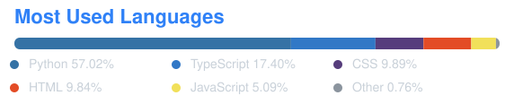

  

# 嗨，我是 [Seal Wang](https://www.sl-vfx.site) 👋

- 🎬 VFX 从业者 · 实时图形与视觉特效方向。
- 🧑‍💻 不做纯艺术，也写工具：TypeScript / Python / Houdini 混合流。
- 🌐 个人作品与实践记录：[sl-vfx.site](https://www.sl-vfx.site)。
- 🛠️ 近期在做：只读型 Windows 本地工具（存储分析、硬件监控）、Next.js + Canvas 的 Web 视觉实验。
- 📄 ORCID: [0009-0003-6248-3327](https://orcid.org/0009-0003-6248-3327)

## 🛠 技能栈

| Property | Data |
|---|---|
| **VFX / 3D** |       |
| **智能体 / AI** |     |
| **Web / 前端** |      |
| **脚本 / 自动化** |     |
| **工具 / 平台** |     |

