<a href="https://www.sl-vfx.site"><picture><source media="(max-width: 600px)" srcset="assets/caru-style/hero-mobile.svg"></picture></a>

  
  
  
  

<picture><source media="(max-width: 600px)" srcset="assets/caru-style/band-projects-mobile.svg"></picture>

| Project | About | Stack |
| :-- | :-- | :-- |
| **[VFX Portfolio](https://github.com/SoulmatelynchVFX/vfx-portfolio)** · [网站](https://www.sl-vfx.site) | 我的特效作品集，包含视频、Canvas 粒子和交互实验。 | Next.js · TypeScript |
| **[SpaceAtlas](https://github.com/SoulmatelynchVFX/spaceatlas)** | Windows 只读存储分析 CLI，查看应用、目录占用并导出报告。 | Python |
| **[Houdini CPU Limiter](https://github.com/SoulmatelynchVFX/houdini-cpu-limiter)** | 为 Houdini 进程树设置 CPU 上限，支持工具架、内嵌面板与独立窗口。 | Python · C# |
| **[PulseAtlas](https://github.com/SoulmatelynchVFX/pulseatlas)** | Windows 桌面悬浮监控，查看 CPU、内存和所选显卡的运行状态。 | Python |
| **[client-rules](https://github.com/SoulmatelynchVFX/client-rules)** | iOS Shadowrocket 原生分流配置与规则检查工具。 | Shadowrocket · Python |

<picture><source media="(max-width: 600px)" srcset="assets/caru-style/band-skills-mobile.svg"></picture>

<picture><source media="(max-width: 600px)" srcset="assets/caru-style/skills-vfx-mobile.svg"></picture>

<picture><source media="(max-width: 600px)" srcset="assets/caru-style/skills-dev-mobile.svg"></picture>

<picture><source media="(max-width: 600px)" srcset="assets/caru-style/skills-ai-mobile.svg"></picture>

<picture><source media="(max-width: 600px)" srcset="assets/caru-style/languages-mobile.svg"></picture>

  
  

Codex 工作台

- **Houdini / Blender** · Pyro、FLIP、程序化裂痕、缓存助手与建模动画脚本。
- **FoodWheel** · 用 Expo + React Native 做的点餐选择轮盘和日记。
- **MewHelp** · 结合知识检索、订单查询和人工转接的电商客服原型。
- **随译** · 支持框选 OCR、剪贴板和手动输入的 Windows 翻译工具。
- **立体几何图解实验室** · 用可旋转图形展示题目与反例。

精选 Fork

- **VFX 与程序化制作** · [SideFXLabs](https://github.com/SoulmatelynchVFX/SideFXLabs) · [HoudiniEngineForUnreal](https://github.com/SoulmatelynchVFX/HoudiniEngineForUnreal) · [OpenVDB](https://github.com/SoulmatelynchVFX/openvdb)
- **AI 与创作工具** · [mcp-for-blender](https://github.com/SoulmatelynchVFX/mcp-for-blender) · [unity-mcp](https://github.com/SoulmatelynchVFX/unity-mcp) · [ComfyUI](https://github.com/SoulmatelynchVFX/ComfyUI)
- **Agent 与模型工具** · [typescript-sdk](https://github.com/SoulmatelynchVFX/typescript-sdk) · [LangGraph](https://github.com/SoulmatelynchVFX/langgraph) · [Ollama](https://github.com/SoulmatelynchVFX/ollama)

