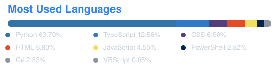

# 嗨，我是 SeeleWang 👋

**视觉特效 · 程序化制作 · 创作工具**

我从事视觉特效，也为创作和日常使用写工具。从 Houdini、Blender 的场景与脚本，到 Windows 桌面工具、作品集网站和交互原型，我喜欢把实际遇到的问题变成自己的小项目，边用边改。

最近也在用 Codex 辅助开发，试 AI Agent、MCP 与创作软件之间的连接。

[个人网站 · sl-vfx.site](https://www.sl-vfx.site) · [公开仓库](https://github.com/SoulmatelynchVFX?tab=repositories) · [ORCID](https://orcid.org/0009-0003-6248-3327)

---

## 自己的公开项目

### SpaceAtlas

面向 Windows 的**只读存储分析 CLI**：查看应用清单、分析指定目录占用，并导出统计报告，不执行删除。

**技术栈：** Python · CLI · 测试覆盖命令行模块

**当前形态：** 原型阶段，仅只读命令行模块入库；网页界面、全盘归属与历史对比尚未发布。原名 `lipan`，2026-10 改名为 SpaceAtlas。

### houdini-cpu-limiter

Houdini CPU 占用上限控制器：工具架、内嵌面板与独立窗口三种入口，按 Windows 进程树设置限额。

**技术栈：** Python · Houdini · Windows 进程 API

### PulseAtlas

轻量**只读硬件监控悬浮窗**：显示真实本机 CPU、内存与所选显卡状态，支持置顶、透明度、折叠和单显卡选择，取不到数据时明确降级。

**技术栈：** Python · Windows API · 实时监控

### VFX Portfolio

把视觉特效作品、技术练习与个人介绍整理成自己的展示空间，线上 [sl-vfx.site](https://sl-vfx.site)。

**技术栈：** Next.js · TypeScript · Tailwind CSS · Framer Motion · Lenis · Canvas 粒子文本

### client-rules

应用分流规则片段（Clash 格式，仅含 rules 段），配套 Python 规则校验工具，便于检查与调整日常使用的配置。

**技术栈：** Python · Clash rules · 配置校验

---

## Codex 工作台

公开仓库之外，还有一些正在本地打磨的小工具和交互实验，从创作流程到今天吃什么都有。

| 项目 / 方向 | 在做什么 |
| --- | --- |
| **Houdini 工具与模拟工作流** | 围绕 Pyro、FLIP、程序化裂痕和缓存流程做脚本与资产实验，也在做支持兼容性检查和后台任务调度的 GPU 缓存助手。 |
| **Blender 建模与动画脚本** | 程序化模型、动作适配与局部动画修正；从具体场景中积累可复用的处理步骤。 |
| **FoodWheel** | 用 Expo + React Native 做一个帮忙决定吃什么的小应用：加权轮盘、吃后日记、避雷偏好、自建候选库和备份。 |
| **MewHelp** | 电商客服原型，把知识检索、来源引用、订单查询、流式回答和转人工串成一个完整流程。 |

---

## 从 Fork 开始探索

下面都是我自己的 fork，用来跟踪源码、尝试工作流和寻找可以改好的地方。

### VFX 与程序化制作

- [SideFXLabs](https://github.com/SoulmatelynchVFX/SideFXLabs) — Houdini 工具与引擎衔接
- [HoudiniEngineForUnreal](https://github.com/SoulmatelynchVFX/HoudiniEngineForUnreal) — 引擎集成
- [openvdb](https://github.com/SoulmatelynchVFX/openvdb) — 体积数据处理
- [MaterialX](https://github.com/SoulmatelynchVFX/MaterialX) — 材质表达系统

### AI 与创作软件连接

- [mcp-for-blender](https://github.com/SoulmatelynchVFX/mcp-for-blender) — 编辑器自动化
- [unity-mcp](https://github.com/SoulmatelynchVFX/unity-mcp) — Unity 集成
- [ComfyUI](https://github.com/SoulmatelynchVFX/ComfyUI) — 节点工作流
- [BrowserSkill](https://github.com/SoulmatelynchVFX/BrowserSkill) — 浏览器操作

### 知识检索与模型应用

- [llama_index](https://github.com/SoulmatelynchVFX/llama_index) — 资料检索
- [LightRAG](https://github.com/SoulmatelynchVFX/LightRAG) — 轻量级 RAG
- [ollama](https://github.com/SoulmatelynchVFX/ollama) — 本地模型运行
- [vllm](https://github.com/SoulmatelynchVFX/vllm) — 推理服务

---

## 🛠 技能栈

| Property | Data |
|---|---|
| **VFX / 3D** |       |
| **智能体 / AI** |     |
| **Web / 前端** |      |
| **脚本 / 自动化** |     |
| **工具 / 平台** |     |

喜欢有意思的视觉效果，也喜欢能省事的小工具。欢迎交流 VFX 工作流、程序化制作、交互体验和 AI 辅助创作。
